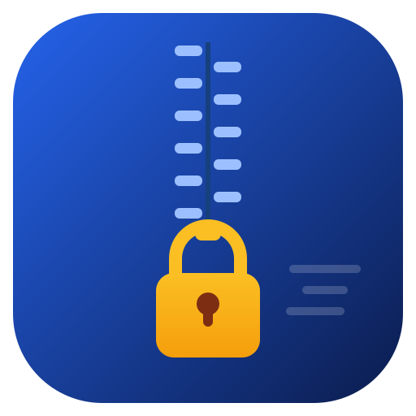
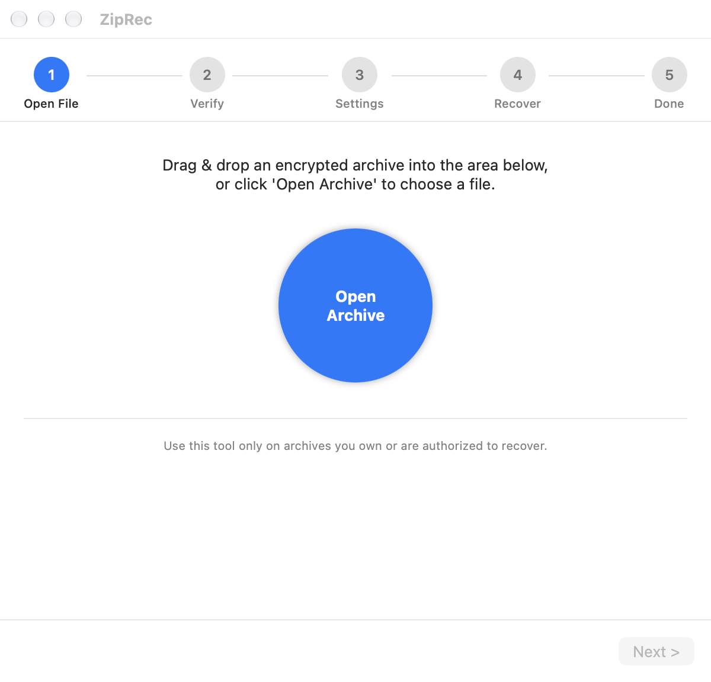

<div align="center">


# ziprec

**High-performance local password recovery for encrypted archives — ZIP, 7z, RAR.**

[](LICENSE)


*A single dependency-free C binary that recovers forgotten archive passwords on your own hardware — no uploads, no servers, everything local.*

</div>

> **Authorized use only.** This tool exists to recover passwords of archives
> you own or are explicitly authorized to open. It cannot "bypass" AES — it
> verifies candidates by actually decrypting data, so it only finds real,
> working passwords.

---

## Why ziprec?

| | ziprec | GUI crackers | John/hashcat alone |
|---|---|---|---|
| One binary, zero deps | ✔ (C11, no libraries) | ✘ | ✘ heavy installs |
| Auto-detect encryption | ✔ ZipCrypto / AES-128/192/256 | ~ | manual format flags |
| GPU acceleration | ✔ hashcat delegation + auto fallback | ✘ rare | ✔ but manual |
| Checkpoint & resume | ✔ single-index bijection | ~ | ✔ |
| Result re-verification | ✔ decrypt + CRC + real `7z`/`unrar` test | ~ | hash output only |
| GUI wizard (macOS) | ✔ SwiftUI, Bandizip-style | — | ✘ |
| Privacy | ✔ offline, no telemetry | ? | ✔ |

## Supported formats

| Format | Identify | Crack path | Integrity verify | Notes |
|---|---|---|---|---|
| ZipCrypto (PKWARE) | general flag bit 0 | **native engine** or hashcat `-m 17210/17200` | decrypt + CRC | millions of pw/s |
| WinZip AES-128/192/256 | extra field `0x9901` | **native engine** or hashcat `-m 13600` | PBKDF2 verifier + HMAC + decrypt | thousands of pw/s (PBKDF2-bound) |
| 7z | magic `37 7A BC AF 27 1C` | `7z2john` → hashcat `-m 11600` or john `--format=7z` | real `7zz t` test | LZMA/LZMA2/stored |
| RAR5 `-p` / `-hp` | magic `Rar!\x1A\x07\x01` | `rar2john` → hashcat `-m 13000` or john `--format=rar5` | real `unrar t` test | incl. header-encrypted |
| RAR3 | magic `Rar!\x1A\x07\x00` | `rar2john` → hashcat `-m 23700/12500` or john `--format=rar` | `unrar t` | implemented, fixture-untested |

## Benchmarks — measured, Apple M3

All numbers are real measurements on this machine, not estimates.

### Native engine — ZipCrypto (`?l?d` × 8-char space)

| Threads | candidates/sec | notes |
|---|---|---|
| 1 | 13.9 M | |
| 8 | **61.2 M** | hardware CRC32 + key-init prefix cache + odometer generator |

### GPU delegation — hashcat on Apple M3

| Format | hashcat mode | Measured | vs native CPU (8t) |
|---|---|---|---|
| ZipCrypto stored | 17210 (Metal) | **~935 MH/s** | **~15×** |
| WinZip AES-128 | 13600 (OpenCL) | 390.9 kH/s | ~13× |
| WinZip AES-256 | 13600 (OpenCL) | **436.6 kH/s** | ~27× |
| 7z (LZMA2) | 11600 (OpenCL) | ~19.0 kH/s | — |
| RAR5 | 13000 (OpenCL) | ~1.96 kH/s | — |

<details>
<summary>Honest hardware notes (read before extrapolating)</summary>

- Apple Metal/OpenCL runtimes **skip the PKZIP deflate kernels**
  (17200/17220/17225) — a known hashcat/driver issue. ziprec works around it
  by preferring a *stored* entry for the exported hash (passwords are
  archive-wide), so most real archives still hit the 935 MH/s path.
- `$7z$0$` hashes (uncompressed payload) can't be verified by hashcat and
  automatically route to john instead.
- **NVIDIA RTX-class numbers are unmeasured** — check `hashcat -b` on your
  own hardware. Hashcat publishes community benchmarks; this project claims
  nothing it hasn't run.
</details>

## Quick start

```sh
git clone https://github.com/koreadeveloper/ziprec
cd ziprec && make            # → ./ziprec, single static binary

# self-test (verifies SHA1/AES backends incl. ARMv8 hardware path)
./ziprec --selftest
```

```sh
# 1. dictionary + rules — the usual first try
./ziprec target.zip -d words.txt --rules best64.rule -t 8

# 2. mask attack — "starts with S, then 5 lowercase, then 2 digits"
./ziprec target.zip -m 'S?l?l?l?l?l?d?d'

# 3. brute force — lowercase+digits, length 4–8
./ziprec target.zip -b --charset '?l?d' --min 4 --max 8

# 4. GPU: delegate to hashcat (auto mode pick + result re-verify + CPU fallback)
./ziprec target.zip -m '?u?l?d?l' --gpu
./ziprec target.7z  -d words.txt --gpu      # works for 7z/RAR too

# 5. interrupt with Ctrl-C → checkpoint saved → resume anytime
./ziprec target.zip -m '?d'*8 --resume target.zip.zck

# archive info only (encryption type, entries, sizes)
./ziprec target.zip --info
```

### Live progress

```
[mask '?d×8'] 58.26M/100.00M (58.3%) 61.2M c/s | ETA 0.7s | 8 thr | cur 58261504
```

- `Ctrl-C` → save checkpoint and exit cleanly
- `Ctrl-Z` → save checkpoint and **pause** (`fg` resumes — GUI has a pause button)

## macOS GUI

A native SwiftUI app wraps the verified engine — Bandizip-style 5-step wizard:
file pick/drag-drop → archive info → recovery settings → live progress with
**current candidate, pause, stop-to-checkpoint** → result with **Copy password**
+ *verified* badge.

```sh
sh gui/build_app.sh     # builds gui/ZipRec.app (swiftc, no Xcode project)
open gui/ZipRec.app
```

<div align="center"></div>

## How it works

```
archive ──► format detect ─┬─ ZIP ──► native engine ───────────────────┐
                           │      (parse → quick_check → full_verify)  │
                           ├─ 7z ───► 7z2john → hashcat/john ──┐       │
                           └─ RAR ──► rar2john → hashcat/john ─┤       ▼
                                                               └─► unrar/7zz integrity test ──► PASSWORD FOUND
```

- **Native engine** (`src/`): own ZIP parser, ZipCrypto/AES crypto
  (PBKDF2-HMAC-SHA1, AES-CTR, HMAC verify), hardware CRC32 + ARMv8 SHA,
  minimal inflate for integrity checks.
- **Index-bijection generators**: every candidate ↔ a `u64` index, so a
  single number is a complete checkpoint — resume is exact, not approximate.
- **Speed tricks**: per-worker key-init prefix cache (consecutive candidates
  share most key setup), odometer cursor (no index→candidate division in the
  hot loop), `crc32`/`sha1` hardware instructions with runtime dispatch +
  self-test, lock-free atomic chunk distribution.
- **Delegation**: export john/hashcat-native hash formats, run the engine,
  then **re-verify the claimed password against the real archive** — GPU
  results are never trusted blindly.

## CLI reference

<details>
<summary>All options</summary>

| Option | Meaning |
|---|---|
| `-d, --dict FILE` | dictionary file (one candidate per line) |
| `--rules FILE` / `--rulestr` / `--rules-builtin` | hashcat-style rules |
| `-m, --mask MASK` | `?l ?u ?d ?s ?h ?a ?b ?1-4`, literals ok |
| `-b, --brute` | exhaustive over `--charset`, `--min`–`--max` |
| `--charset X` | charset spec (`?`-tokens or literal chars) |
| `-t, --threads N` | worker threads |
| `--start N`, `--target N`, `--chunk N` | search-space control |
| `--check-bytes 1\|2` | ZipCrypto header check override |
| `--ckpt F`, `--ckpt-interval S`, `--resume F`, `--no-ckpt` | checkpointing |
| `--gpu` | delegate to hashcat (+auto fallback) |
| `--gpu-args "…"` | extra args (e.g. `-r rules/hybrid.rule`, `-d 2`) |
| `--export` | print john/hashcat hash for the archive |
| `--bench`, `--selftest`, `--info` | diagnostics |
| `--log FILE`, `--log-pw`, `-q` | logging (passwords never logged unless `--log-pw`) |
| `-y, --yes` | skip the ownership-confirm prompt |

</details>

## Localization

**Auto-detected, 7 languages:** English, 한국어, 日本語, 简体中文, Español,
Deutsch, Français.

- **CLI** — detection order: `--lang XX` flag → `ZIPREC_LANG` →
  `LC_ALL`/`LC_MESSAGES`/`LANG`/`APPLE_LANGUAGE` → Windows UI language →
  English. Machine-parseable output lines (`stopped:`, `verified:`,
  `exhausted:` …) intentionally stay English so scripts and the GUI keep
  working under any locale.
- **GUI** — standard `Localizable.strings`; follows the macOS system
  language automatically. Override per-run:
  `ZipRec -AppleLanguages "(ja)"`.

## Security & privacy

- No network code — anywhere. Runs fully offline.
- Source archive is opened **read-only**; the file is never modified.
- The password is printed to stdout and (optionally) the GUI only —
  it is never written to logs unless you pass `--log-pw` yourself.
- Recovered candidates are proven by decrypting real data (and for 7z/RAR,
  a real `7zz t`/`unrar t` integrity test), not by checksum match alone.

## Limitations & roadmap

- Windows MSVC build is written for portability but **not yet tested** on
  real hardware (`build_windows.bat` provided — reports welcome).
- Delegated 7z/RAR path has no progress display or checkpoint (the external
  engine runs as-is; results are still re-verified).
- RAR3 path implemented but untested (can't create RAR3 fixtures with rar 7.x).
- Roadmap: native Metal kernel for deflate-ZipCrypto on Apple GPUs,
  hashcat `--session/--restore` integration, Windows GUI.

## Testing

```sh
sh tests/test.sh        # 15 E2E tests: per-format recovery, mask,
                        # checkpoint/resume, exhaustion, 7z/RAR5 delegation
tests/unit <zip> <pw>   # low-level verify (quick_check + full_verify)
sh tests/make_fixtures.sh   # regenerate fixtures (zip, 7zz; RAR needs `rar`)
```

Delegated paths need `john` (jumbo), `7zz`, and for GPU `hashcat`;
RAR verification needs `unrar` or `rar`.

---

## 한국어 요약

**ziprec** — 잊어버린 아카이브 비밀번호를 로컬에서 복구하는 고성능 도구.
ZIP(ZipCrypto·WinZip AES-128/192/256)은 네이티브 C 엔진, 7z/RAR는
hashcat/john 위임 + 실제 아카이브 무결성 재검증.

- 네이티브: ZipCrypto **61M/s**(M3, 8스레드), 하드웨어 CRC/SHA + 접두사 캐시
- GPU: ZipCrypto ~**935 MH/s**, AES-256 ~**27×** 가속 (M3 실측)
- 사전+규칙/마스크/전체탐색, 체크포인트 중단·재개, Ctrl-Z 일시정지
- macOS SwiftUI 마법사 GUI (일시정지·현재 후보·비밀번호 복사 포함)
- 완전 오프라인, 비밀번호는 로그에 남기지 않음(기본)

> 본인 소유이거나 복구 권한이 있는 아카이브에만 사용하세요.

## License

MIT — see [LICENSE](LICENSE).
